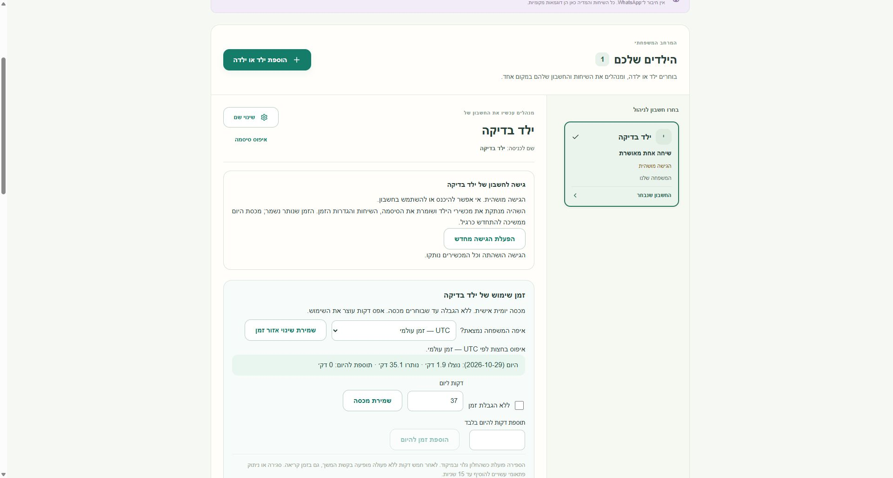
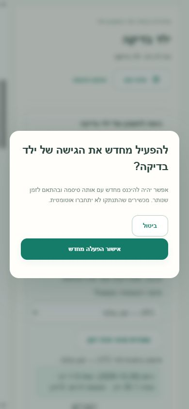

# Child access pause / resume — local validation

Date: 2026-10-29. Base: `586c8d489904be0cb7819bb2a7fa6d22d63d07de`
(`origin/main`, application 0.5.3). Branch: `feat/child-access-pause`.
Worktree: `C:\projects\yahad-child-pause`. Runtime: Node 24.21.0, Python 3.13.

Follow-up: the [independent code review](child-access-code-review.md) found and
fixed three P2 issues (delayed usage requests, local media preparation before
provider submission, and the packaging test's schema expectation). Its final
rerun passed 296 Node tests with 2 existing skips and 12 Python tests. The
historical validation counts below describe the initial implementation round.

## Result

Parents can pause or resume one child in the existing child-management workspace.
Both actions name the selected child and require explicit confirmation. Cancel and
Escape do not mutate anything. Focus stays inside the confirmation and returns
to its opener. Busy, stale and changed-revision states block another submission.
Success is shown only after a fresh matching overview confirms the revision.

`PUT /api/parent/child-access` accepts only `{childId, paused, revision}`.
It requires a same-family parent session, origin and CSRF. A transaction settles
usage through server time, revokes leases, persists the new access revision and
deletes every session belonging to that child. Credentials, grants, signature,
history, daily policy, used time and bonus time are retained. Other children and
the parent remain connected. No-op/replayed requests do not revoke new sessions
or new usage leases. A stale request cannot undo a later opposite transition.

Login rechecks the access revision after password verification. A pause/resume
during that wait cannot mint an obsolete session. Session validation and content
authorization reject paused accounts; pending content responses recheck session
validity before delivery. Open SSE expires on the access-change notification.
Resume requires a fresh login and never revives an old cookie or usage lease.

Pause does not freeze the family calendar: normal midnight resets still apply.
An exhausted daily allowance remains exhausted after pause/resume. A parent may
edit the budget or add time while access remains paused; neither operation
bypasses the access pause.

## Database boundary

Schema **6**, migrated from schemas 1–5, adds `child_access` with a family/child
foreign key, a paused flag and a monotonically increasing revision. This must be
a policy version boundary: older code must not ignore a saved pause. The actual
schema-5 `Store` from the exact base was run against a fresh synthetic schema-6
database and rejected it with `Unsupported database schema`; the saved pause
remained intact (`SCHEMA5_REFUSES_SCHEMA6_OK`).

The application schema declaration, migration smoke fixtures and matching local
account-recovery script/tests were updated together. Package version remains
0.5.3 because this is an unreleased development commit; select a new release
version before publication. No release or installer package was created.

## Validation

All tests used fresh temporary synthetic families with `connector: 'mock'` and
`realAllowed: false`. No real WhatsApp or household account was connected.

| Check | Result |
| --- | --- |
| TypeScript `tsc --noEmit` | Passed |
| Vite build with `resolve.preserveSymlinks: true` in the sandbox | Passed, 1,628 modules |
| `scripts/update-smoke.ts --database-schema 6 --database-migrations-from '[1,2,3,4,5]'` | `SMOKE_OK`; every declared source covered |
| Focused child access, UI handler, child management, family progress and usage suite | 59/59 passed |
| Final feature, migration, unread and tablet suite after fixes | 23/23 passed |
| Final server/tablet regression after review, including paused-tablet navigation | 14/14 passed |
| Broad Node suite excluding five environment-dependent files below | 292 passed, 2 skipped, 0 failed (294 tests) |
| Python `test_recovery.py` with TEMP/TMP inside this worktree | 10/10 passed |
| `git diff --check` | Passed |

The feature tests cover same-family authorization, missing auth, child/foreign
parent refusal, CSRF/origin, strict input, all child sessions, old cookies after
resume, idempotency, stale opposite requests, concurrent password verification,
pending content after pause/resume, open SSE expiry, restart persistence,
transaction rollback on storage failure, clock rollback, quota exhaustion,
bonuses, unchanged grants/credentials/signature, and sibling isolation.

An initial full Node run had 294 passes, 21 failures and 2 skips. Three failures
were fixed here (two schema expectations and the new socket-based SSE fixture,
now tested through Fastify injection). The remaining **18 failures** were
reproduced on the exact unchanged base exported under `.local/baseline` in these
five files: `diagnostics-updates.test.ts`, `shutdown-sse.test.ts`,
`update-mode.test.ts`, `update-recovery-gate.test.ts`,
`update-target-binding.test.ts` (baseline: 6 passed, 18 failed). They involve
Windows/sandbox loopback, filesystem ownership/private queue and symlink
assumptions. They were not relaxed or changed. The full suite is therefore not
claimed green on this Windows host.

Detailed local logs remain under `.local/`: `targeted-tests.log`,
`final-feature-tests.log`, `final-server-tablet.log`,
`node-tests-excluding-baseline-environment.log`, `baseline-environment-tests.log`,
`recovery-tests.log`, `migration-smoke.log`, `older-schema-proof.log`,
`typecheck.log`, `build-sandbox.log`.

## Browser checks

Chrome on a separate loopback mock-only server, fresh synthetic family:

- Desktop: open confirmation, Shift+Tab wrap, Escape cancellation, pause success,
  preserved 37-minute policy and approved chat, blocked child login with the
  unchanged password and explicit pause explanation, resume confirmation and
  success, fresh child login with that same password and the original approved
  chat, continuing time budget.
- Mobile 390 × 844: both confirmations fit; document width equals viewport
  width (390), keyboard focus remains inside the dialog, cancel leaves access
  unchanged. Temporary viewport override was reset.
- Final rebuilt UI: a paused child's tablet guidance points to child access
  management instead of WhatsApp connection.

## Verification limits / environment notes

No production deployment, push, PR, merge, release, Actions run, system permission
change or installer execution was performed. `C:\projects\yahad` stayed clean.
`C:\projects\yahad-first-install` stayed clean at
`bd4c50093df7ffee0446c6730f38684b88bda812`; its processes, installation and files
were untouched. The installer payload was not rebased onto this candidate.

Already downloaded content cannot be erased remotely, and an operation already
handed to a provider before pause cannot be recalled. The UI explains the local
content limit. Real-provider behavior, real tablets, native installation and
Linux updater checks remain outside this synthetic validation.

An initial escalation for the normal Vite build was not executed because the
automatic approval reviewer was at capacity. The safe sandboxed build above
resolved that. One browser documentation read was also not executed for the
same capacity reason. A sandboxed local test listener timed out from Chrome;
a separately approved mock-only loopback listener enabled the browser checks.
These transient issues do not leave a feature blocker.
