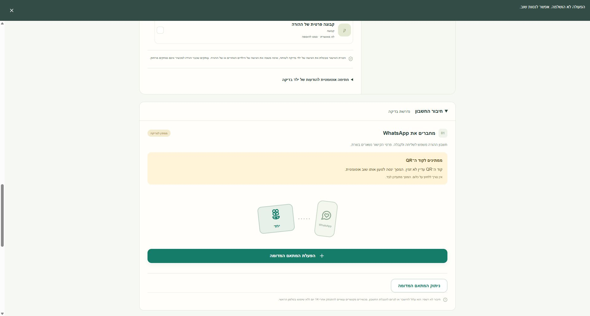
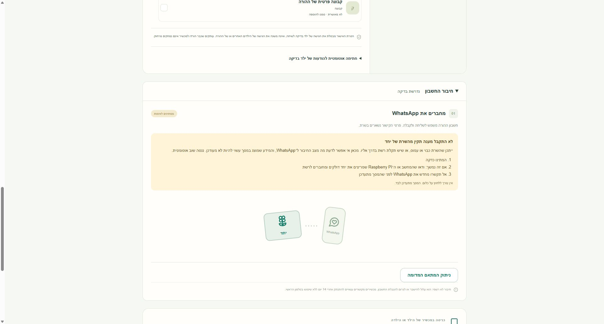

# CONNECTION-01 and child access pause: local integration

Date: 2026-10-29. Worktree: `C:\projects\yahad-access-connection`.
Branch: `feat/connection-child-pause-integration`.
Parent/base: `c4d02fe4b88ecfd785d6e6bc43dba5872bec2316` (reviewed child pause).
Runtime: Node **24.21.0**, Python **3.13.7**, Chrome on Windows.

## Source identity and integration

The user supplied `C:\Users\nehor\Downloads\verified-connection-01.patch`.
Before application its bytes were verified as **19,970**, SHA-256:
`13e10e8646c563574f7910ebdeef2939e40dd2707a6f4deb4fa1abc519b6ae54`.
The same hash was rechecked after integration. The downloaded source was not
modified. This is the full CONNECTION-01 v2 patch against
`586c8d489904be0cb7819bb2a7fa6d22d63d07de`, not a delta against another patch.

The earlier Library transfer attempts did not install a file (the Windows helper
could not apply xattrs). Work resumed only after the user's explicit local
delivery; no additional Library retry, URL reconstruction or metadata workaround
was used. A verified copy remains under `.local/verified-connection-01.patch`.

The patch was applied in the dedicated integration worktree. One overlapping CSS
append was resolved by retaining **both** child-access styling and the new
connection-guidance styling. No existing checkout or source branch was reset.

The requested `ChatCelebrationView` module-name fix was taken as the minimal
already-existing change from local commit
`5e4eb7bc621b48e41845f1c1696fa91956524c67`: rename the component file and update
the main/test imports. Component contents are unchanged; no installer-branch
changes were imported. `onAccess` and the complete child pause/resume flow remain
in `main.tsx`.

Windows TypeScript resolution exposed a new case-insensitive name collision
between `ConnectionGuidance.tsx` and `connectionGuidance.ts`. The component
module was therefore named **`ConnectionGuidanceView.tsx`**, with its exports
unchanged, and main/test imports updated. This matches the unambiguous View/state
separation used for the celebration module and compiles on Windows.

## Missing QR behavior

`main.tsx` passes `qrVisible: !!qr`. A successful overview whose state is `qr`
but has no QR image produces `qr_pending`, with the exact requested text:

> קוד ה־QR עדיין לא זמין. המסך ינסה לטעון אותו שוב אוטומטית.

The guidance has no scan steps, requires no QR action, and does not claim that a
code is displayed. Once a QR image exists the existing scan instructions return.
The retry cadence, reconnect/reset actions and server mechanisms are unchanged.
QR-read failure remains separate from overview failure and clears an old QR.

The screenshot's request-error notice is the existing foreground API error
notification caused by the deliberately injected QR failure. The successful
overview and confirmed pause/resume state remain authoritative; the QR guidance
continues to show the pending-code explanation.

## Independent integration review

Separate agent `review_connection_pause_integration` reviewed the combined diff
without editing tracked files. It found one **P2**: after a previously connected
overview, the new error guidance was hidden inside a closed `
`, while
the summary still said connected.

Fixed in `main.tsx`: an unavailable overview/browser connection opens the details,
uses a neutral summary/pill instead of a fresh connected claim, and suppresses the
connected-success note. The existing connect-button behavior and retry/reset
mechanism were retained. A regression executes the actual Parent function and
checks both failed overview and browser-offline states, plus the healthy case.

The reviewer independently verified **35/35** targeted tests, typecheck and
`git diff --check`; its own actual-Parent harness confirmed the disclosure fix.
No further actionable or blocking findings were reported. Three durable
actual-Parent rendering tests were additionally run by the implementing agent.

## Final combined validation

| Check | Result |
| --- | --- |
| Broad Node suite, excluding only the five unchanged environment-dependent files below | **312 passed, 2 existing Linux-only skips, 0 failed, 0 cancelled; 314 total** |
| Actual Parent rendering regressions | **3/3 passed** |
| Independent reviewer targeted run | **35/35 passed** |
| TypeScript `tsc --noEmit` | Passed |
| Vite build (`resolve.preserveSymlinks: true` to stay inside the Windows sandbox) | Passed, 1,630 modules |
| Migration smoke with `--database-schema 6 --database-migrations-from '[1,2,3,4,5]'` | `SMOKE_OK` |
| Python parent recovery and offline packaging-contract fixtures | **12/12 passed** |
| `git diff --check` and unresolved-conflict scan | Passed |

Combined tests cover child pause/resume mutations and lost responses while QR
reads fail, superseded QR responses after a newer child/connection overview,
missing versus visible QR rendering, stale/offline connection disclosure,
celebration module/rendering behavior, authorization/CSRF/session races, usage
and bonus preservation, schema 6 and recovery/package contracts.

Chrome checks used only a fresh mock family on loopback:

- QR endpoint failure: `qr_pending` visible, no QR image or scan instructions.
- Pause and resume both succeeded during that failure; the approved chat remained
  checked and the same daily quota remained configured.
- A synthetic QR becoming available produced one image and the scan instructions.
- After a healthy connected overview, an overview failure opened the connection
  disclosure, changed the summary to attention needed, removed green connected
  indicators and disabled stale child editing.
- Returning to connected cleared the problem card and restored the quiet summary.
- Browser console contained no errors/warnings. Test tabs and the exact synthetic
  QA process were closed after checks.

No new full-suite-green claim is made for this Windows sandbox. The same five
files were excluded as in the reviewed child-pause work:
`diagnostics-updates.test.ts`, `shutdown-sse.test.ts`, `update-mode.test.ts`,
`update-recovery-gate.test.ts`, `update-target-binding.test.ts`.
They are unchanged in this integration. The prior exact-base run produced
6 passes and 18 environment failures. Their per-test excerpts and byte/hash
evidence remain in [the baseline report](child-access-environment-failures.md)
and [JSON evidence](child-access-environment-failures.json).

Logs are under `.local/integration-{broad,build,final-typecheck,migration,python}.log`
and `.local/integration-parent-render.log`. Earlier intermediate logs are not
the final validation record.

## Preserved scope and limitations

The entire `src`, `scripts` and `deploy` trees are unchanged relative to the
reviewed child-pause parent `c4d02fe`; schema 6, recovery, packaging and server
pause protections are therefore preserved byte-for-byte. Only web components,
their tests and evidence are integrated. The separate pending timer-end UX bug
was not changed.

`C:\projects\yahad-child-pause` remains clean at `c4d02fe`. The main checkout
remains clean. Installer work was not changed or run; another concurrent line of
work advanced `C:\projects\yahad-first-install` from the previously observed
`bd4c500` to clean `040fcd410e6c035da0cac20cdb3920999f2c3999` during this task.
That advancement is outside this integration diff.

All accounts, messages, QR payloads and provider transports were synthetic.
No real data, real WhatsApp, physical tablets, native installation, Linux updater
execution, system permissions or installer process was involved. No push, PR,
merge commit, release, publication or deployment was performed.

Package version still reflects the development base's 0.5.3 with schema 6. A new
release version and the appropriate release checks are required before any
publication. Existing limits remain: a provider submission already started
cannot be reliably recalled, and cancelled sends retain the conservative
`SEND_UNCERTAIN` UX documented in the child-pause review.
