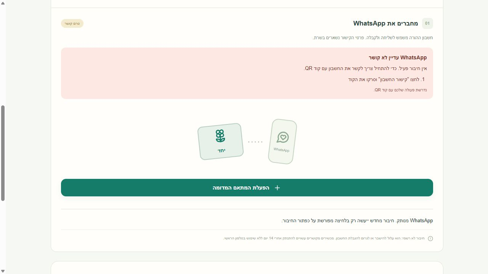
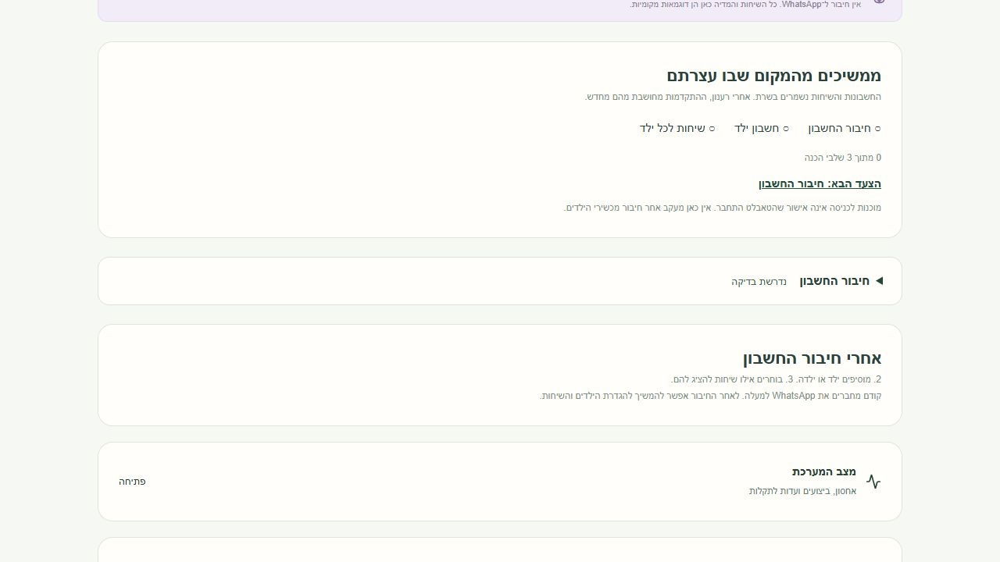

# Parent setup: connect WhatsApp before children and chats

Date: 2026-10-29. Base: `0bf1e9d4d71221fcb77c6aa2b2213aaf4ea0a5ae`.
Branch: `fix/parent-account-first`.
Worktree: `C:\Users\nehor\Documents\Codex\2026-10-29\task-3\yahad-parent-onboarding`.

## Behavior

The connection disclosure now precedes child management and tablet setup in the actual DOM and visual flow. A fresh family sees connection as the active first step and explanatory text for the subsequent child/account and chat steps. Child controls appear after an overview confirms `connected`.

Existing persisted children or a saved chat catalog keep family management available independently of connector state. This covers interrupted setup and completed families during idle, connecting, QR, reconnecting, needs-pairing and conflict states. Existing freshness checks still disable edits when an overview cannot be verified. No browser-local setup-complete flag or database migration was introduced.

`linked` is deliberately NOT used as successful-connection evidence: `Service.connectFamily` writes it before the connector completes startup, including QR pairing. The independent reviewer found this P1 in the first implementation; it was corrected and covered with `linked:true` first-run tests.

Connection actions are disabled until overview loading finishes, during stale/offline reads, and while connection/QR/reconnection is pending. Retry remains available in idle, needs-pairing and conflict states. The server retains responsibility for connection work; polling, SSE, authentication, data and permissions are unchanged.

## Synthetic browser verification

All browser work used a disposable mock-only server bound to `127.0.0.1`, a new temporary SQLite database and `realAllowed:false`. No real family, device or WhatsApp account was used. The fixture and screenshots are test-only; no synthetic information was added to the production path.

Verified in the built app through the browser:

- New idle family: connection first; child controls absent.
- Connecting: waiting state, disabled repeat button, still no child controls after reload.
- Failed pairing: explicit retry enabled; retry returned to connecting and survived reload (exactly two deliberate connect requests).
- Connected: child creation becomes available; creating one synthetic child selects that account and exposes unapproved chat choices.
- Empty catalog: zero approval checkboxes; existing empty-state explanation and enabled refresh; retry leaves the list empty without inventing chats.
- One synthetic grant: saved confirmation; completed setup checklist disappears. Navigating to parent chats, returning to management and reloading preserves the selected child and checked grant.
- Temporary reconnect after completed setup: child management and pause control remain enabled; saved grant remains checked; provider catalog refresh is disabled until reconnected.
- Final fresh fixture reproduces real `linked:true` during connecting: after reload there are **zero child creation buttons**, with the waiting button disabled.
- No browser warning/error logs in the main scenario run.

Screenshots use the unchanged app CSS. The second capture manually collapses the native disclosure for legibility; a fresh unconnected screen opens it automatically. A temporary iframe capture was rejected by the app's framing policy; its headers were not weakened, and direct-page screenshots were used instead.

## Validation

Runtime: Node 24.21.0. Existing installed dependencies were reused through a worktree-local ignored junction; no package installation or lockfile change.

- Final focused actual-Parent rendering/state and family-progress/overview-race tests: **19 passed, 0 failed**. Includes the review correction.
- Independent read-only reviewer reran the final **19/19**, reviewed the revised diff and `git diff --check`, and reported no further actionable findings. The reviewer edited no files.
- Final TypeScript `tsc --noEmit`: passed.
- Final Vite production build: passed, **1,630 modules**. Used the repository's root/output settings with `configFile:false` and `resolve.preserveSymlinks:true` to avoid writing Vite's config cache into the shared dependency junction. The initial default-cache attempt failed with sandbox `EPERM`; no source/dependency mutation was used to bypass it.
- Broad full Node suite before the final review correction: **342 total, 322 passed, 18 failed, 2 skipped**. The subsequent correction only removed `linked` from the UI predicate and strengthened the focused cases; final targeted tests, typecheck and build were rerun. No full-suite-green claim.
- The 18 failures are in the same five unchanged files already documented in the base's [environment failure evidence](child-access-environment-failures.md): `diagnostics-updates.test.ts`, `shutdown-sse.test.ts`, `update-mode.test.ts`, `update-recovery-gate.test.ts`, `update-target-binding.test.ts`. The source/server/updater trees and these files have no diff from the requested base.
- `git diff --check`: passed.

Logs remain under `.local/onboarding-{full-tests,final-targeted,final-build,final-typecheck}.log`. The mock fixture is `.local/onboarding-browser-qa.ts` and is not committed or imported by production.

## Scope

Only the parent UI, focused rendering regressions and this evidence were changed. No installer or message-support work was incorporated. No push, PR, merge, release, installation, network/system permission changes, real WhatsApp connection or real family-data access occurred. Physical devices and a real provider connection were not tested.

## Cleanup

The two host-visible mock QA processes were stopped after checking their exact process IDs and command lines (26164 and 10812); the temporary screenshot frame file was removed. Both successful QA tabs were closed. Rebinding the initial timeout error tab (ID 1) for cleanup was denied by Browser Use's `data:` URL policy before a close could be issued; no workaround was attempted. It is an unmarked temporary agent tab and is subject to automatic end-of-turn cleanup. This does not block the code deliverable.

The designated source checkout was rechecked: clean, still at the requested base commit. No concurrent worktree was touched.
